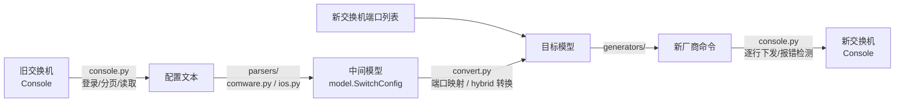

# 开发文档

## 架构



| 模块 | 说明 |
|---|---|
| `swmigrate/console.py` | `SerialConsole`：串口收发（后台线程读取）；`SwitchSession`：登录、首次开机交互、厂商识别、关闭分页、自动翻页、简易终端渲染（处理 `ESC[nD` / 退格，清除 `---- More ----` 残留）、逐行下发与错误识别、保存 |
| `swmigrate/parsers/base.py` | 按缩进切分配置段；兼容华三/华为"`#` 后缩进一格的全局命令" |
| `swmigrate/parsers/comware.py` | 华三 Comware V5/V7、华为 VRP 解析 |
| `swmigrate/parsers/ios.py` | 锐捷 RGOS、思科 IOS 解析 |
| `swmigrate/model.py` | 中间模型：`Interface`、`Svi`、`Vrrp`、`Route`、`Ospf`、`SwitchConfig` |
| `swmigrate/ifname.py` | 接口名统一为 `(kind, nums)`，如 `("10GE", (1,0,49))`，并按厂商规范输出 |
| `swmigrate/convert.py` | `auto_map()` 端口自动映射；`build_target()` 重命名接口、hybrid 转换、汇总警告 |
| `swmigrate/generators/__init__.py` | 生成华三/华为/锐捷/思科命令 |
| `swmigrate/gui.py` | tkinter 界面，耗时操作在工作线程执行，通过队列回到主线程更新界面 |
| `swmigrate/cli.py` | 命令行离线转换 |

## 本地运行

```bash
pip install -r requirements.txt
python main.py                 # 图形界面
python main.py --selftest      # 自检（打包后可用来验证）
python main.py --cli samples/h3c_s5560_sample.cfg --to ruijie
```

## 测试

`tests/fake_switch.py` 实现了一个模拟交换机（兼容 pyserial 接口），可模拟登录、分页、命令报错：

```bash
python -m tests.test_e2e
```

测试内容：

1. 登录模拟的 H3C 旧交换机，带分页读取配置，与原始配置逐行比对
2. 连接模拟的锐捷新交换机，读取 28 个端口
3. 验证自动端口映射（`Ten-GigabitEthernet1/0/49 → TenGigabitEthernet 0/25`）
4. 生成配置并逐行下发，验证能正确识别出设备返回的错误命令，并执行保存

## 新增一个厂商

1. `swmigrate/__init__.py`：在 `VENDORS` / `VENDOR_NAMES` 中注册。
2. `swmigrate/ifname.py`：在 `VENDOR_NAMES` 中添加接口命名，`_SEP` 中设置名称和编号间是否有空格；如有特殊缩写，加入 `_PREFIX`。
3. 解析：语法接近 Comware/VRP 的复用 `parse_comware`，接近 IOS 的复用 `parse_ios`，否则新增 `parsers/xxx.py` 输出 `SwitchConfig`。
4. 生成：在 `generators/__init__.py` 中添加生成函数。
5. 会话：在 `console.py` 的 `SwitchSession.prepare()` 中添加识别规则、关闭分页命令，在 `get_config()` / `get_interfaces()` / `save()` 中添加对应命令；必要时扩充 `ERROR_PATTERNS`。
6. 在 `samples/` 中添加示例配置并补充测试。

## 新增一类配置

1. 在 `model.py` 中添加字段；
2. 在两个解析器中识别命令（注意从 `unparsed` 列表中移出）；
3. 在 `convert.build_target()` 中处理接口改名等；
4. 在生成器中为 4 个厂商输出命令；
5. 更新 [SUPPORTED_COMMANDS.md](SUPPORTED_COMMANDS.md)。

## 打包

| 平台 | 方式 |
|---|---|
| Windows exe | `build_windows.bat`（PyInstaller `--onefile --windowed`） |
| macOS app | `build_mac.sh`（PyInstaller `--windowed`） |
| Windows 绿色版 | 内置 [python-build-standalone](https://github.com/astral-sh/python-build-standalone) 运行时 + 源码 + pyserial，`Start-SwitchMigrator.bat` 用 `pythonw.exe` 启动 |
| 自动构建 | 推送 `v*` 标签后，GitHub Actions（`.github/workflows/build.yml`）会在 Windows / macOS 上自动打包并上传到对应 Release |

PyInstaller 不支持交叉编译，Windows 版需在 Windows 上打包，Mac 版需在 Mac 上打包（或使用 GitHub Actions）。

## 发布新版本

```bash
# 1. 修改 swmigrate/__init__.py 中的 __version__，更新 CHANGELOG.md
git commit -am "release: v1.1.0"
git tag v1.1.0
git push origin main --tags
# 2. GitHub Actions 自动构建并把安装包附加到 Release
```
